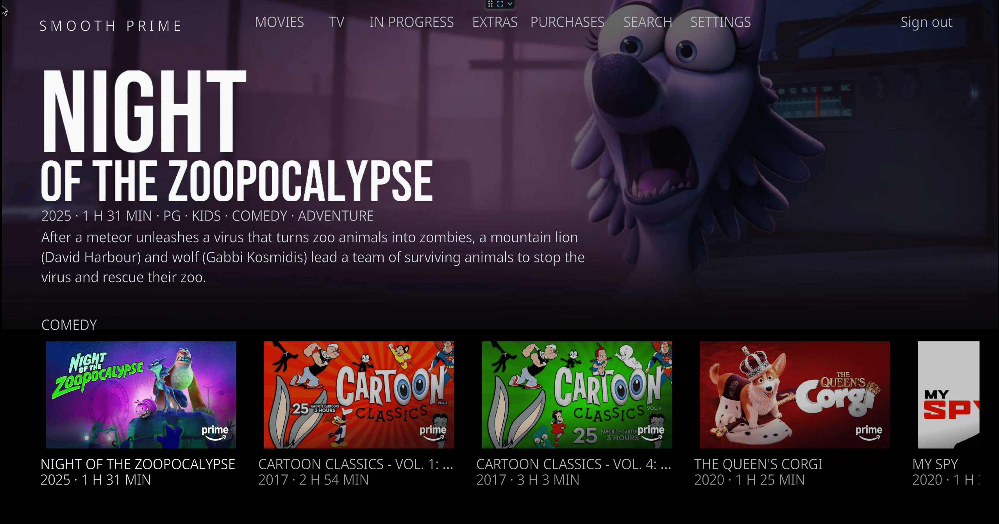
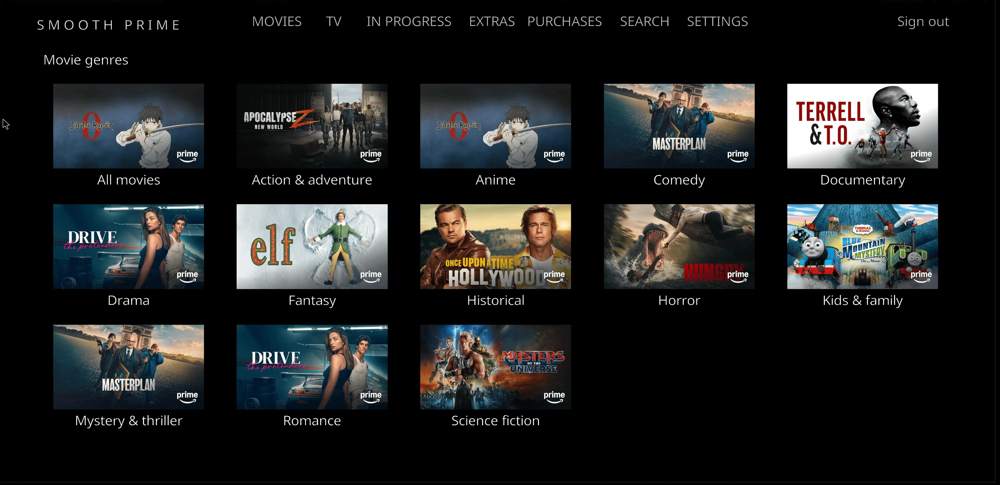
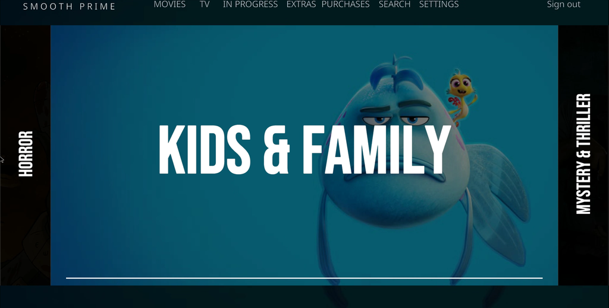
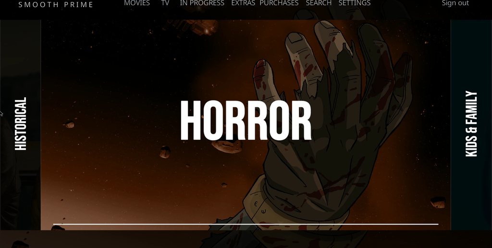

# Smooth Prime for Kodi

Independent native Prime Video catalog, account and playback backend, maintained
by AgreeWithScotty. The dedicated Aurora Cinema interface is adapted from Scott's
SmoothFlix. Native account verification, fresh In Progress, Prime-included Movies
and TV, Sports, Purchases, description/artwork preloading and originating-card
playback return use one permanent add-on: plugin.video.primeinterface.

## Current developer installer: 0.2.69

[Download the 0.2.69 installer](https://raw.githubusercontent.com/AgreeWithScotty/PrimeScene/main/packages/plugin.video.primeinterface/plugin.video.primeinterface-0.2.69.zip). Failed HDCP sessions are discarded before playback, repeated automatic native probing after failure is avoided, and catalog return is queued asynchronously. Genuine CDM protection requests, native HD and all accumulated fixes are retained. Physical NUC outcomes still await user testing. Windows x64 HD automatically provisions a fixed private Chrome runtime directly from Google on first use. No separate browser install or automatic browser updates. Playback remains in stock Kodi. Includes all accumulated fixes. Main/testing update only; no public release promotion.

## Screenshots

Install/update through Prime Scene Repository or ScottyWins. Repository file-manager
address: https://agreewithscotty.github.io/ScottyWins/
Source and installable releases: packages/plugin.video.primeinterface/
Current readable backend source: source/rewrite/. Complete source is inside each ZIP.

Playback uses Kodi InputStream Adaptive and Widevine with your Amazon account.
InputStream Helper handles Kodi's supported CDM setup. Settings includes account,
playback, updates and complete diagnostics. No external browser playback or original
Amazon add-on installation is required. See the package NOTICE.md and LICENSE.
Historical releases retain their original source/license notices.
